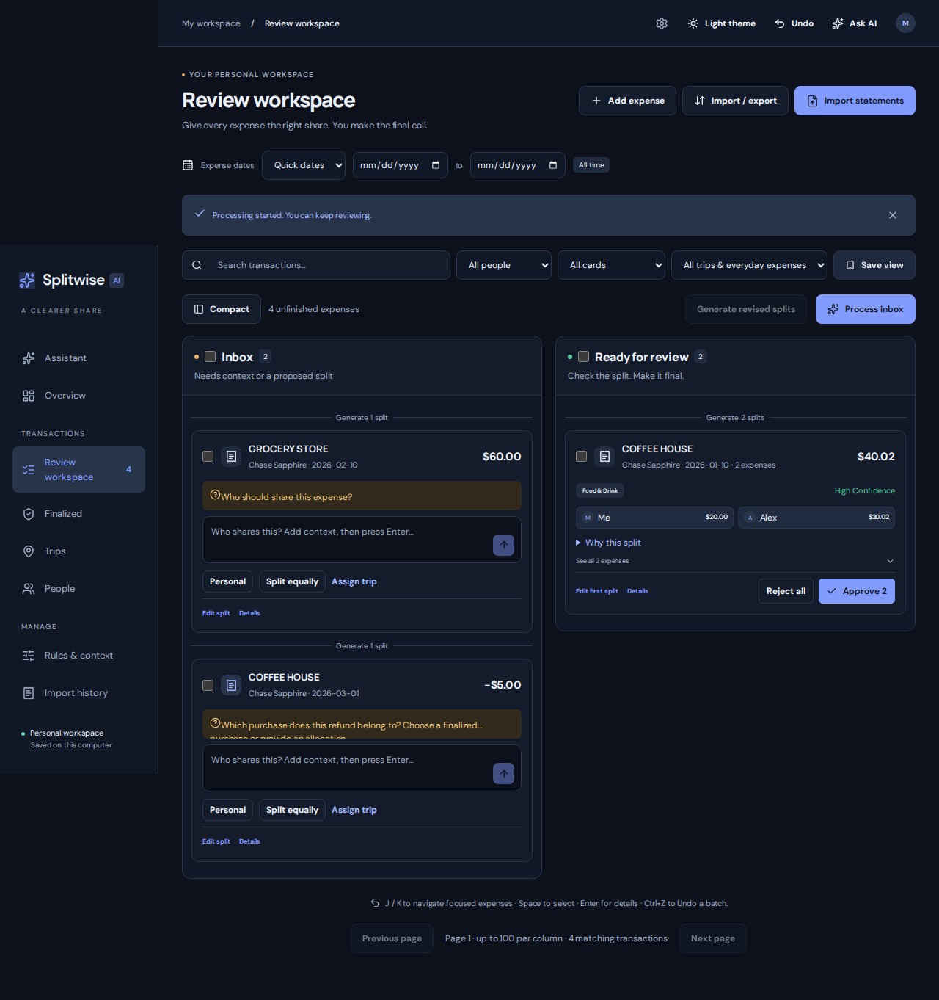
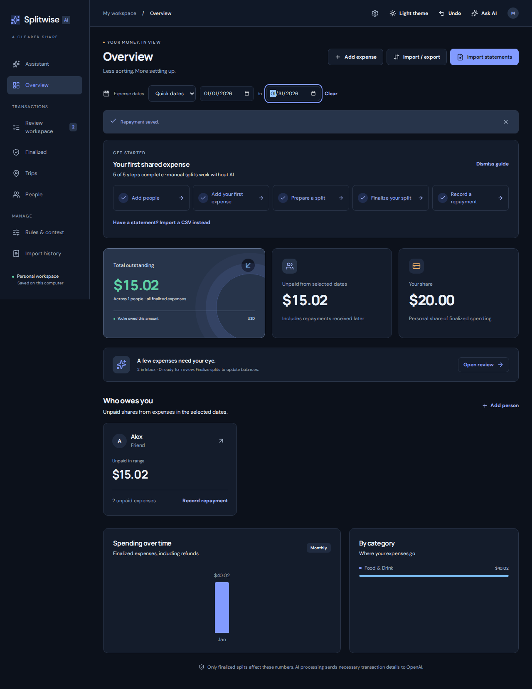
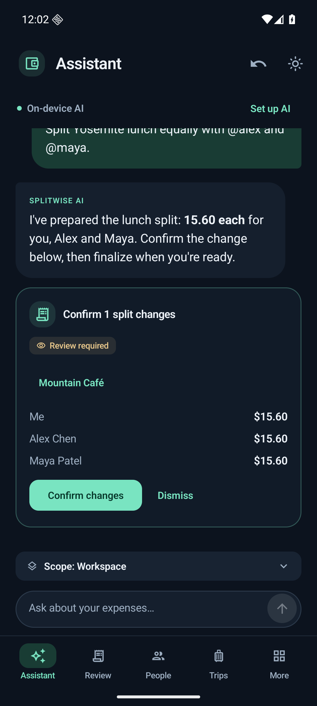
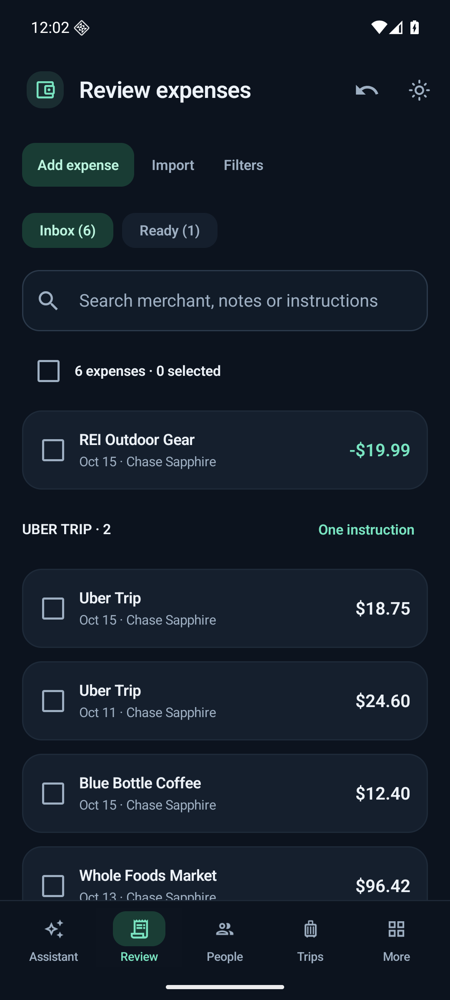
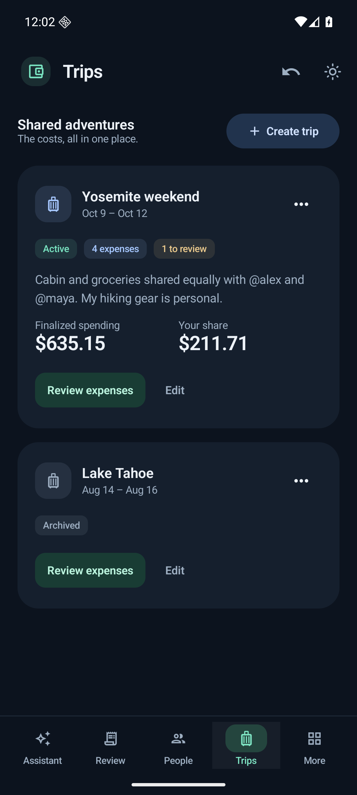

# Splitwise AI

A personal expense workspace with a conversational assistant, a webapp, and a native Android app. Import statements, organize shared expenses, review proposed splits, and track what people still owe you. Supports Chase Sapphire, American Express, and Chase Prime CSV exports, plus manual expenses. Standalone; no connection to the Splitwise service.

Choose hosted AI or an experimental, fine-tuned Gemma E2B model in the webapp. Android runs Gemma on the device. The application calculates exact shares, validates actions, and requires explicit user confirmation for expense changes and repayments.

## Screenshots

### Webapp

| Review shared expenses                                                                                                                                                                                                    | Track spending and outstanding balances                                                                                                                                                         |
| ------------------------------------------------------------------------------------------------------------------------------------------------------------------------------------------------------------------------- | ----------------------------------------------------------------------------------------------------------------------------------------------------------------------------------------------- |
| <a href="docs/screenshots/web-review.png"></a> | <a href="docs/screenshots/web-overview.png"></a> |

### Android app

| Assistant and confirmation cards                                                                                                                                                                         | Inbox and expense review                                                                                                                                                                                 | Trips and shared context                                                                                                                                                                                                 |
| -------------------------------------------------------------------------------------------------------------------------------------------------------------------------------------------------------- | -------------------------------------------------------------------------------------------------------------------------------------------------------------------------------------------------------- | ------------------------------------------------------------------------------------------------------------------------------------------------------------------------------------------------------------------------ |
| <a href="docs/screenshots/android-assistant.png"></a> | <a href="docs/screenshots/android-review.png"></a> | <a href="docs/screenshots/android-trips.png"></a> |

Screenshots use synthetic sample expenses and people. Web captures come from the browser workflow test with mocked AI; Android captures show the real app in an emulator, with a seeded demo conversation and ledger-backed confirmation card. They illustrate the interface, not measured model performance. Click an image for full resolution. [Screenshot sources](docs/screenshots/README.md).

## Features at a glance

- **Conversations that prepare actions:** describe a split, trip, recurring rule, or household fact. The assistant can organize the workspace and prepare expense and repayment cards.
- **Statement import and manual entry:** preview CSV imports, detect duplicates, capture context, and add cash, rent, or other expenses outside a statement.
- **Review before balances change:** Inbox/Ready workflows, equal/exact/percentage splits, explicit confirmation, separate finalization, version checks, and persistent Undo.
- **Reusable organization:** merchant rules, split templates, readable merchant names, and saved facts scoped to a person, trip, or date range.
- **Trips and reporting:** trip defaults with individual exceptions, expense assignments, unpaid balances, recorded repayments, date filters, and settlement-summary downloads.
- **Private storage and portability:** SQLite workspaces, receipt attachments, JSON/CSV transfers, complete workspace backup/restore, and isolated signed-in workspaces in production.
- **Small-model experimentation:** a saved webapp model choice and an Android import path for the experimental fine-tuned model, with reproducible training and tool-call evaluations.

The webapp and Android app have independent workspaces after a transfer; there is no automatic synchronization. Expenses are USD amounts you paid, rather than complete multi-payer group accounting.

**Android setup:** the standalone Kotlin/Compose app, on-device Gemma assistant, full workspace restore, and USB installation scripts are in `android/`. See [Android build and phone setup](docs/android.md).

To test the mobile app on Windows, double-click **Start Android App.cmd**. It opens the Android app in an emulator, keeps its workspace between sessions, and loads the verified local E4B model when available. See [desktop testing](docs/android.md#manual-desktop-testing).

## Start in WSL

From Ubuntu:

```sh
cd /path/to/splitwise_ai
./start.sh
```

Open **http://127.0.0.1:3000**. The launcher installs a project-local native Node 24 LTS runtime if needed, verifies the download checksum, installs locked dependencies, and starts the web app and worker. Stop both with Ctrl+C.

After the first launch installs the runtime, run npm commands in a new Ubuntu terminal from the repository directory:

```sh
export PATH="$PWD/.tools/node/bin:$PATH"
```

Use Ubuntu Node, rather than Windows Node, with this database. The app and SQLite file stay on the WSL filesystem. The server binds to loopback and checks host/origin. Local mode has no authentication and is restricted to loopback. **Production mode requires OIDC sign-in and isolates each invited user in a private SQLite database.** See [Production deployment](docs/production.md).

For a compiled build that remains local-only:

```sh
APP_MODE=local ./start.sh --production
```

For internet access, use the separate [production deployment guide](docs/production.md) and its HTTPS/container configuration. Production mode refuses to start without identity settings and requires explicit database migration.

### Enable AI

For **Hosted AI**, set **OPENAI_API_KEY** in the ignored **.env.local**, then restart. **OPENAI_MODEL** defaults to **gpt-6-luna**. Do not put the key in browser code or Git. On a fresh checkout:

```sh
cp -n .env.example .env.local
```

For **Fine-tuned Gemma E2B**, start the local model service alongside the webapp:

```sh
npm run model:local
```

Then select **Workspace settings → AI model → Fine-tuned Gemma E2B (experimental) → Save preferences**. It runs on the app server's computer, needs no OpenAI key, and applies to chat and AI-assisted processing. If it is unavailable, requests fail explicitly without switching to hosted AI. The converted model and Java runtime must already be provisioned; model weights are not included in Git. See [local web model setup](docs/gemma4-web-model.md).

Android can import the separately supplied fine-tuned `.litertlm` file through its AI model settings. See [fine-tuned Android test build and installation](docs/gemma4-android-v2.md). Model loading and desktop runtime smoke checks have passed; physical-phone validation of this candidate is still pending.

Without a hosted key or a running local model, imports, approved rules, manual splits, review, repayments, and reporting still work. Unresolved expenses stay in Inbox. **AGENT_MODE=mock** is exclusively for automated tests with synthetic data.

The interface uses **Midnight**, a modern navy theme with restrained blue accents, and a matching light theme. The top-bar switch remembers your choice across reloads. Compact review, readable split amounts, mobile Inbox/Ready tabs and a detail drawer keep common actions close.

## Why fine-tune a small model for expense tasks?

A fluent answer is only part of an expense assistant's job. A request such as “Split this $12 lunch equally between @me and @alex” needs the right operation, real participant IDs, the selected expense's current version, and a valid tool call. Saving a recurring rule, asking for clarification, and preparing a one-off split are different actions. A small general-purpose model can understand the sentence while still getting that application contract wrong.

Fine-tuning on complete tool-use trajectories teaches the model how the app expects work to be done: choose an operation, supply its arguments, read the tool result, and finish with an appropriate reply. The v2 curriculum includes answer-only requests, clarification, supported and unsupported actions, scoped facts, and combinations of tasks. It adapts model behavior to the workflow; the user's ledger and changing balances remain in the database.

This is useful for bounded local assistants: a compact model can specialize in recurring application workflows while requests stay on the app's computer or phone, without a hosted API dependency. The training examples need to cover exceptions, missing information, and failed tools as well as successful actions. General fluency alone does not establish reliable task completion.

This project pairs that training with a **reduced tool interface**. Fixed retrieval rules expose relevant tools, and application code supplies observed record versions, converts dollars and percentages to ledger units, and fills an omitted expense ID only when exactly one expense is selected. This reduces bookkeeping the model must generate correctly. The model still chooses the operation, participants, and requested scope; the ledger computes rounded shares and validates the result. In the lunch example, the application calculates two 600-cent shares from the proposed equal split.

### What the experiment measured

Two independent QLoRA adapters were trained from the same official Gemma 4 E2B checkpoint on **2,476 synthetic training episodes**, with one epoch per adapter. They saw the same semantic examples, serialized for either the full or reduced interface. No held-out scores were used for checkpoint or hyperparameter selection.

| Configuration                           | Fresh held-out completion | Original benchmark completion |
| --------------------------------------- | ------------------------: | ----------------------------: |
| Base model, full tools                  |             12/128 (9.4%) |                65/140 (46.4%) |
| Base model, reduced interface           |            26/128 (20.3%) |                90/140 (64.3%) |
| Broader fine-tuning, full tools         |            99/128 (77.3%) |               106/140 (75.7%) |
| Broader fine-tuning + reduced interface |       **104/128 (81.2%)** |           **110/140 (78.6%)** |

Broader training supplied most of the completion gain; the reduced interface added a smaller gain. This supports combining task-specific training with a simpler application contract when using small models. Training is not automatically a speed improvement: the combined model's held-out median was **16.22 seconds**, versus **14.04 seconds** for the base/full configuration, though it was faster than the trained/full configuration at 18.19 seconds.

These are matched **CUDA/NF4 experiment results**, not Android or web-serving benchmarks. The cases are synthetic and related templates are correlated, so the percentages do not estimate production reliability. The converted mobile bundle uses a different runtime and quantization.

**The fine-tuned model remains experimental.** The best configuration still fails 24/128 fresh cases and 30/140 original cases. Clarification regressed from 15/15 to 10/15; the model can guess who “my friend” means and sometimes claim success after a rejected call. Fine-tuning does not replace version checks, validation, truthful completion summaries, or explicit user confirmation.

See the [full v2 results and failure analysis](docs/gemma4-experiment-v2.md), [reproduction protocol](finetuning/gemma4-e2b/experiment-v2.md), [webapp integration](docs/gemma4-web-model.md), and [Android conversion and checks](docs/gemma4-android-v2.md).

## A conversation-first workspace

**Assistant** is the home page. Describe a trip, an expense, a recurring split or a household fact. Chat can create and edit trips, add clearly identified people, manage active rules and saved user context, save templates and merchant names, and answer balance questions. Import and receipt uploads remain accessible through the interface.

For example: “We went to Yosemite from June 1–3, 2028 with @alex. Food was shared equally.” The assistant creates the trip when dates and people are clear, or asks one focused question for missing details. Trip membership is suggested separately and requires confirmation.

Rules and user facts are saved **automatically**, with visible action receipts and persistent Undo. Allocation rules define what to split; user context stores facts separately with person, trip and optional date scopes. View, correct or forget them in **Rules & context** or in chat. Facts must come from user messages or saved user instructions, never statement text.

Every agent-generated **transaction change** waits for an explicit confirmation card, including Inbox/Ready moves, revised allocations, trip assignments, manual expenses and repayments. **Confirm split changes** applies the proposed allocation to its review state. **Finalize N splits** is a separate user action in chat that changes balances; the review board remains available. Stale cards fail atomically and must be regenerated. The agent has no finalization, reopening, approval or repayment-write tool.

Automatic rule and trip edits affect future processing. They do not move existing transactions or rewrite accepted allocations. Existing proposals that reference an older definition must be regenerated before final approval. Previously imported or manually saved rule drafts remain available for review; new agent rules are active immediately.

## Trips and everyday expenses

Create a trip with dates, participants, an equal/fixed/percentage default and optional context. Dates produce a suggestion list; select expenses explicitly before assigning them. Flight bookings outside the trip dates can be attached from Review or Finalized using **Assign trip**. A transaction belongs to at most one trip.

Trip pages show assigned counts, unfinished review, finalized cost and your finalized share. **Review trip expenses** opens the scoped review workspace. Defaults without extra context run locally; context with possible exceptions is checked by AI. **Trip default** applies the saved split directly when you choose it. Individual instructions and manual splits handle exceptions. A manual trip edit returns unfinished proposals to Inbox. An automatic assistant edit preserves states; proposals based on old trip defaults require regeneration before approval. Finalized allocations stay unchanged. Archive after every assigned expense is finalized, and reopen when needed.

**Add expense** records cash, rent and other expenses outside statements. It creates an Inbox item with you as payer, optional notes and an optional trip. Retry protection prevents double entry. Manual source records remain separate from CSV duplicate detection.

Open an expense’s **Details** to view original source fields, saved context, action history and receipt attachments. PNG, JPEG and PDF receipts are limited to 5 MB each and ten per expense. They stay inside the private SQLite ledger, are downloaded as attachments, and are included in full workspace backups. Removing a receipt supports Undo. Transaction/rule JSON exports do not contain receipt files; use a full workspace export for complete recovery.

These trips cover **USD expenses you paid**. Other payers and currency conversion are not represented as complete group balances. No Splitwise publishing or external synchronization is enabled.

## Faster review and organization

Use **Personal**, **Split equally**, **Use last split**, or a saved template to prepare proposals. Similar Inbox merchants are grouped; their single instruction applies to the group. Select multiple expenses and choose **Give one instruction** for a scoped conversation. All generated splits still wait for your approval.

**Rules & context** includes split templates and merchant display names. Templates support equal shares, exact amounts and percentages, and run only when you explicitly apply them. Merchant aliases preserve original statement labels; searches and approved rules can match the readable name. Alias changes affect future processing, not finalized allocations.

Save named filters with **Save view**, use quick date presets, and return to the same view after refresh or browser Back. Saved views remain in this browser and are separated by workspace identity. Focus an expense and use **J/K** to navigate, **Space** to select, **Enter** for details and **Ctrl+Z** for Undo.

The assistant scope selector makes **Workspace**, **Selected expenses**, and **Current trip** explicit. Trip requests are resolved to assigned unfinished IDs on the server. Completed replies link back to proposal review. The agent can manage trip setup directly and prepare confirmation cards for assignments, expenses and repayments. It cannot approve or execute financial actions or change finalized records.

Overview includes a getting-started checklist. Dismiss it when finished, or restore it from Settings. Person and trip pages provide **settlement summary** downloads with currently unpaid amounts, including repayments received later. You decide how to share the file; the app sends no reminders or messages.

## Quick instructions and chat

Every Inbox expense has an instruction box. Type a split and any useful context, then press **Enter** to process that expense immediately. **Shift+Enter** adds a line. Use **@** to choose a person; Enter first accepts the highlighted mention. Clear instructions produce a confirmation card. Apply it to move the expense into Ready for review; ambiguous ones stay in Inbox with a question.

The complete instruction is saved under **Saved context**, including details such as what a purchase was for or which trip it belonged to. Earlier notes remain available when you add a follow-up. Context is searchable and remains visible after finalization through **View saved context**. Transaction context is one-off. Reusable rules and broader user facts are managed automatically and shown in chat.

New assistant rules activate automatically and appear as saved-change cards below the reply. Rules can match merchant, card, category and date scope. Ask chat to update, delete or optimize them. Existing manual/imported drafts remain visible for review; they are not silently activated as part of a migration.

Chat supports Markdown replies, growing input, Enter-to-send, live reply text and activity, queued requests, Stop/Retry, and links back to the relevant expense. It opens at the latest message and lets you read older messages without being pulled back down. Selected unfinished expenses scope a request; their full chat instructions are attached as context. For unselected requests, the agent can attach relevant exact quotes from your message to unfinished expenses. AI still cannot modify finalized expenses.

Open **Settings** in the top bar to choose your workspace timezone, manage card accounts, review AI consent and monthly usage, download a complete workspace, or sign out. Production users must enable AI processing explicitly before starting agent jobs. Conversation, context, import timestamps and repayment date defaults use the saved timezone.

## Context after a CSV import

After confirming a new statement CSV, the optional **Context** step shows the card and observed dates of the expenses actually added. Share a trip, guests, or a temporary split arrangement, and use @ autocomplete to name people. **Use a narrower date range** limits the context to a subset of those new expenses. Skipped duplicates, card payments, older imports, and other cards stay untouched.

Choose **Save context & process** or **Save context & finish**. Leaving the field blank keeps **Process now** and **Finish for now** available. Import-only reuploads with no new expenses skip the context prompt. Processing is queued atomically after context is saved and identical retries cannot start it twice.

Context is one-off, attached to each scoped expense under **Saved context → From statement import**, searchable and retained after finalization. It is also recorded as the context provided in import history and travels with transaction JSON exports. Context instructions take priority over broader rules during future processing; the assistant manages reusable rules separately and automatically. Undo can remove the saved context/instruction batch while the original import and its historical receipt remain.

## Import and export your data

Use **Import / export** above any page, or **Import / export rules** on the rules page. Choose Transactions or Rules.

- **Transactions JSON** preserves integer-cent amounts, dates, card accounts, saved splits, instructions, notes with timestamps, source rows, and refund links. Export all records or filter by dates and state. Related purchases and finalized refund history accompany a selection to preserve links and cumulative rounding.
- **Transactions CSV** is a spreadsheet copy with human-readable amounts and allocations. Text that could be interpreted as a spreadsheet formula is escaped. Use JSON for importing back into this app; bank CSVs continue through **Import statements**.
- **Rules JSON** includes active rules and optionally pending proposals, with merchant alternatives, card/date/category scopes, exact/percentage allocations, and participant details. Deleted and rejected rules are excluded.

JSON files use the versioned `splitwise-ai` format, version 1, USD. Referenced people are included and matched by their unique @handle; new people and relationships are visible in the preview. Existing names and relationships are never overwritten. Review and acknowledge these matches before importing.

Every import has a preview. Duplicate transactions are matched by source ID or occurrence counts of normalized financial details, across card accounts. Identical first-import purchases remain distinct. Rules use normalized definitions after participant mapping, including duplicates within the same file. Proposed skips show their existing match, require explicit acknowledgement, and can be kept as distinct records. Existing transactions and rules are never overwritten. A workspace change invalidates the preview; **Refresh preview** recalculates matches. Confirmation is atomic and cannot apply the same preview twice. Invalid JSON, unsupported versions/currency, malformed records, unresolved references, and ID collisions are rejected explicitly before anything is imported.

Imported transactions with saved splits enter **Ready for review**; those without splits enter **Inbox**. Previously finalized records need approval again. Linked refunds retain their links and saved allocations in Inbox so the original purchase and refund order can be reviewed first. Imported rule definitions become **proposals**, with a single Undo batch for the imported proposals. They require normal approval before activation. Imports alone never change balances.

These exports contain transactions or rules and the people they reference. They exclude repayments, chat history, jobs, approval history, and inactive rule history. Use the database backup/restore commands below for a complete workspace copy. JSON uploads are limited to 10 MB, 50,000 transactions or 5,000 rules per file. Large exports can be split by date.

## Rules, context, and cleanup

Keep allocation **rules** separate from descriptive **context**. A rule says what to do (for example, split DoorDash equally with a named person). Context says what something means (for example, that person is a roommate, or a purchase was for a hiking trip). Person relationships and saved transaction notes already live outside the rule definitions. General user-profile facts should have their own context records rather than being converted silently into allocation rules.

The Rules & context page includes **Delete rule** and **Optimize rules**. Delete retains the rule in history, returns its unfinished rule-based proposals to Inbox, and supports Undo; finalized splits and transaction context remain intact.

Optimize runs locally without an API call. Its preview identifies normalized duplicates and merges rules whose only difference is their merchant alternatives. Card, bank-category, date scopes, split amounts/percentages, and output category must agree. Merchant alternatives are an OR list; matching coverage and precedence remain the same. Conflicting instructions are flagged for review. Select cleanup groups and apply them as one atomic, undoable batch. A changed rule or unfinished proposal invalidates the preview and requires refresh. Valid unfinished proposals retain their allocations and reference the surviving rule; outdated proposals return to Inbox.

## Workflow

1. **Add people.** Choose a unique @handle and an optional relationship. Mention autocomplete supports arrow keys and Enter. Mentions resolve to stable person IDs.
2. **Import statements.** Select the specific card account. Review transaction/posting date ranges, duplicates, card payments, and invalid rows. Every proposed skip needs acknowledgement. “Keep as distinct” preserves a known separate occurrence.
3. **Process now or later.** New expenses/refunds start in Inbox. Card payments stay in import history and never affect balances.
4. **Review.** Active rules run first. Apply the confirmation card for generated changes before expenses enter Ready; uncertain items remain in Inbox. Expand merchant groups and approve/reject individually or in bulk. Approve immediately finalizes a split.
5. **Correct.** Enter personal, equal, exact, or percentage splits directly. Or save individual instructions and use Generate revised splits. The assistant saves recurring rules automatically, while one-off instructions stay with the expense.
6. **Manage rules in chat.** The assistant saves, updates, deletes and optimizes rules without another approval. Date/card/category scopes override broader instructions; equally applicable conflicts require clarification. Request reprocessing explicitly to revise existing unfinished expenses.
7. **Settle up.** Record repayments, partial repayments, and returns of available credit. Open a person’s card for expense/repayment details.
8. **Undo.** Reverse the latest completed review, agent, rule, or repayment batch; repeat across sessions. Imports and adding people are retained. No redo.

Only finalized splits affect balances. Finalized transactions are read-only to AI. Only you can reopen them, which removes their allocations until approved again.

### Import behavior

Supported headers:

- Amex: Date,Description,Amount
- Chase: Transaction Date,Post Date,Description,Category,Type,Amount,Memo

Chase formats are identical, so account selection is mandatory. Positive Amex purchases and negative Chase purchases become positive expenses; refunds become negative. Original rows are preserved.

The importer inspects every row; ordering and filenames do not define coverage. Fingerprints include account, transaction/post dates, normalized description, amount, and expense/refund/payment kind. Occurrence counts preserve identical purchases: two identical rows on first import remain two; three later matching occurrences add one. Overlapping dates can contain new/backfilled transactions.

Files have a 10 MB / 50,000-row limit. Malformed syntax/wrong headers block preview. Individual invalid rows require explicit acknowledgement to skip.

Reference statements were validated separately: Amex 129 source rows / 11 payments / 118 workflow transactions; Prime 200 / 7 / 193; Sapphire 626 / 13 / 613. **Real sample data is not seeded or committed.**

### Money, refunds, and dates

Amounts use integer cents. Equal/percentage splits distribute rounding cents deterministically. Exact amounts must total the transaction, and percentages must total 100%. No implicit remainder is charged to you.

Refunds can link to finalized purchases and reverse the accepted split proportionally. Repeated partial refunds use cumulative rounding to avoid over-refunding a participant. Linked refunds cannot exceed the remaining original amount. Unmatched/ambiguous refunds need your allocation. Refund approval never edits the original.

Repayments apply to oldest outstanding expenses first, with stable ID as a date tie breaker. Excess payments remain as credit; returned money cannot exceed available credit. Linked refunds reduce their original expense before remaining credits and repayments are allocated. Reopening recalculates balances while preserving repayment history.

The date filter shows **what remains unpaid from expenses in that range now**, including payments received later. Main outstanding remains all-time. Spending/category/monthly summaries use finalized transactions dated in the selected period. USD only.

## Architecture

- Next.js, React, TypeScript, Node route API.
- SQLite, Drizzle schema/migrations, WAL, foreign keys, busy timeout, atomic bulk writes.
- Durable background job queue with lease/heartbeat, checkpoint cursor, cancellation/retry, and idempotent step keys.
- [OpenAI Agents SDK](https://developers.openai.com/api/docs/guides/agents/sdk) on Responses; one agent, Zod function contracts, qualitative confidence, local conversation history, store:false, hosted tracing disabled.
- Domain services own arithmetic, expected-version checks, permissions, finalization, and inverse snapshots for persistent Undo.
- Agent writes buffer until a run succeeds, then apply transactionally. Processing uses batches of 20. Failed/cancelled runs retain completed batches; retry resumes from the checkpoint.
- Rules and scoped user context are visible, versioned and undoable. Assistant changes are buffered until successful completion; transaction actions are stored as durable confirmation requests.
- Agent tools can search records/context and balances, prepare splits, maintain rules/context/trips/people/templates/aliases and prepare financial confirmation cards. They cannot finalize, reopen expenses, apply confirmation cards, execute repayments, run SQL, access files or make arbitrary network calls.
- Fonts are bundled locally. Necessary transaction details go to OpenAI when AI is enabled. Files, keys, and databases remain outside Git.

### Server interfaces

All routes start with **/api**. Mutation bodies are JSON except multipart import previews and receipt uploads. The browser is the user authority; agent tools call domain services with a fixed agent actor.

| Method | Route                                              | Purpose                                                                 |
| ------ | -------------------------------------------------- | ----------------------------------------------------------------------- |
| GET    | /state?from=YYYY-MM-DD&to=YYYY-MM-DD               | Workspace and balances                                                  |
| GET    | /health                                            | Local server health                                                     |
| POST   | /imports/preview                                   | Multipart file and accountId                                            |
| GET    | /imports/:id                                       | Retained row decisions and payment history                              |
| POST   | /imports/finish                                    | Save optional date-scoped context and atomically queue processing       |
| POST   | /imports/confirm                                   | Preview ID, skip acknowledgements, retained duplicate row numbers       |
| POST   | /people                                            | Name, unique handle, relationship                                       |
| POST   | /transactions/instruct                             | Save Inbox instruction/context and queue that expense atomically        |
| POST   | /transactions/proposal                             | Manual split/category, expected version, optional original purchase     |
| POST   | /transactions/review                               | Atomic approve/reject/reopen/correct with IDs and expected versions     |
| POST   | /rules/propose                                     | New/edit rule proposal                                                  |
| POST   | /rules/review                                      | User approval/rejection                                                 |
| GET    | /transfer/export                                   | Download transactions JSON/CSV or rules JSON                            |
| POST   | /transfer/preview                                  | Multipart JSON file and transactions/rules kind                         |
| POST   | /transfer/confirm                                  | Preview ID, skip/person acknowledgements, retained duplicate rows       |
| POST   | /rules/delete                                      | Version-checked deletion with persistent Undo                           |
| GET    | /rules/optimize/preview                            | Local duplicate/merge preview and revision                              |
| POST   | /rules/optimize/apply                              | Apply selected cleanup groups atomically with Undo                      |
| POST   | /repayments                                        | Person, date, cents, direction, note, stable requestId for retry safety |
| POST   | /trips/save, /trips/archive, /trips/assign         | Versioned trip organization and explicit expense assignment             |
| GET    | /trips/:id/suggestions                             | Paginated suggestions from trip dates                                   |
| POST   | /transactions/manual, /transactions/quick          | Retry-safe manual entry and atomic quick proposals                      |
| POST   | /templates/save, /templates/delete                 | Manage split templates with Undo                                        |
| POST   | /aliases/save, /aliases/delete                     | Manage readable merchant names with Undo                                |
| GET    | /transaction-source/:id, /transaction-files/:id    | Original fields, action history and receipt metadata                    |
| POST   | /attachments/upload, /attachments/delete           | Add or remove a private receipt                                         |
| GET    | /attachments/:id, /settlements/:personId           | Download a receipt or current unpaid summary                            |
| POST   | /assistant-requests/:id/apply, /dismiss, /finalize | Explicit user confirmation, dismissal and final split approval          |
| POST   | /context/delete                                    | Forget a saved fact with version checks and Undo                        |
| POST   | /onboarding                                        | Dismiss or restore the checklist                                        |
| POST   | /undo                                              | Undo latest completed batch                                             |
| POST   | /jobs                                              | Process selected/Inbox transactions or chat                             |
| GET    | /jobs/:id/events                                   | Stream progress                                                         |
| POST   | /jobs/:id/cancel                                   | Cancel unfinished work                                                  |
| POST   | /jobs/:id/retry                                    | Resume failed/cancelled work                                            |

Shared contracts live in **src/lib/types.ts**. State, version, batch ID, cent amounts, participant IDs, confidence, and proposal source are explicit. Stale writes conflict or leave changed transactions untouched; refresh and regenerate.

## Backup and restore

With the project Node runtime on PATH:

```sh
npm run backup
npm run backup -- ./backups/my-backup.sqlite
```

Backups use SQLite's consistent online backup API and can run while the app is open.

Stop the app, then restore:

```sh
npm run restore -- ./backups/my-backup.sqlite --confirm
```

Restore checks integrity/application tables, migrates a temporary copy, preserves a backup of the current database, and replaces it. It refuses while the launcher lock exists. **DATABASE_PATH** overrides the default **./data/splitwise.sqlite**. Keep separate backup copies outside Git.

## Verification

```sh
npm test
npm run typecheck
npm run build
npm exec playwright install --with-deps chromium
npm run test:browser
npm run test:live
npm run test:production          # Run after build; synthetic production sign-in gate
npm run test:container           # Docker Compose, HTTPS/OIDC and encrypted recovery
npm run test:eval                # Synthetic mocked-agent regressions
npm run test:eval -- --live      # Opt-in billable model evaluations
npm run test:assistant             # Conversation capability regressions
npm run test:assistant -- --live    # Opt-in live trips, memory and rule checks
npm run check:secrets
npm run check:secrets -- --history # Also scan old commits before making a repository public
npm run validate:samples -- /path/to/sample-directory
```

Domain tests cover imports, duplicate counts, rounding, precedence/conflicts, authorization, stale edits, bulk review, persistent undo, refunds/repayments, and recovery. Browser tests use an isolated synthetic database and mocked AI for the complete workflow and mobile layout. The opt-in live smoke test uses synthetic data and skips without an API key.

Git includes source, migrations, synthetic fixtures, and the dependency lockfile. Statements, keys, databases, test artifacts, backups, logs, and the downloaded runtime are ignored.

Before making the repository public, follow the [public-release privacy checks](docs/public-release.md), including the Git history scan. Publish Git-tracked source rather than an archive of the full local workspace.

### Model tool-calling benchmark

The [141-scenario benchmark](benchmarks/tool-calling/README.md) compares GPT-6 Luna with the pinned Gemma 4 E2B/E4B models using a shared tool catalog and real ledger validation. It includes anonymized web-chat patterns, argument-level grading, scoped and multi-action requests, clarification, safety checks, latency, API usage, and a searchable trace report. All runs use synthetic in-memory ledgers.

See the [measured comparison](docs/tool-benchmark.md) for CPU/GPU results, the GPU precision finding, and the app's separate fast equal-split check.
